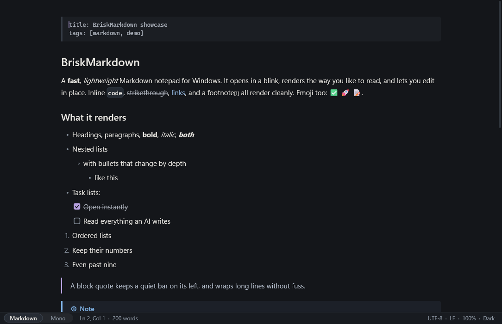
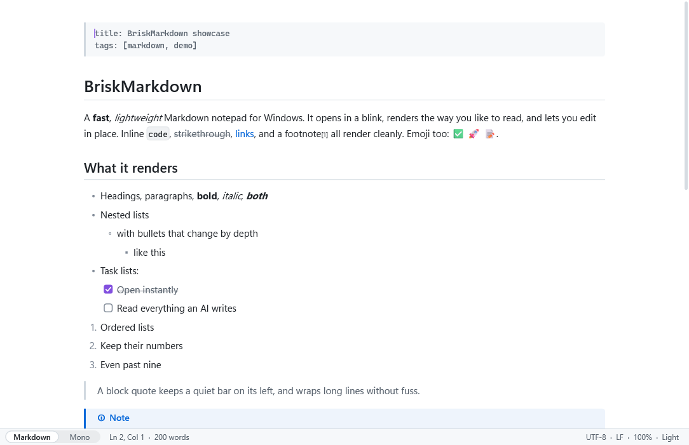
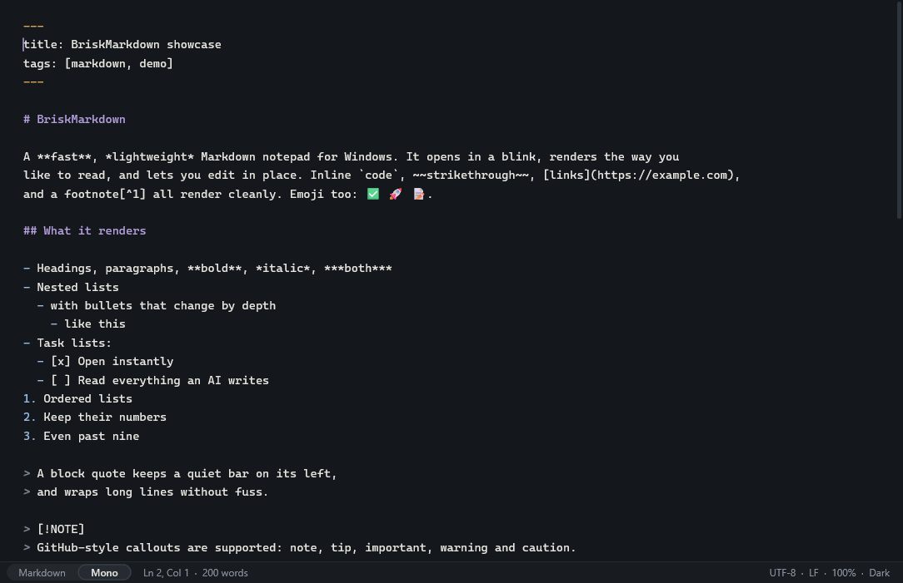

<p align="center"></p>

<h1 align="center">BriskMarkdown</h1>

<p align="center"><b>A Markdown notepad for Windows that opens instantly.</b><br>
One small .exe. Styled reading by default, the plain source one keystroke away.</p>

<p align="center"></p>

## Why

Most Markdown readers are web browsers in disguise: they take seconds to open, use hundreds of
megabytes, and bring a workspace, a sidebar and last week's files along with them.
BriskMarkdown is a notepad for `.md` files: double-click a file and it's on screen, styled, in
about 40 milliseconds. Close it and it's gone.

## Features

- **Instant.** A native Win32/Direct2D program with no runtime and no browser engine. The
  styled document is on screen within about 40 ms of launch, even for large files.
- **Two modes, one keystroke apart.** *Markdown mode* shows the document styled and lets you
  type into it. *Mono mode* shows the exact source in a monospace font.
  <kbd>Ctrl</kbd>+<kbd>/</kbd> switches, and the caret stays at the same height on screen.
- **Renders what AI tools write:** headings, lists, task lists, tables (with alignment), code
  blocks with syntax colouring for about 40 languages, block quotes, GitHub callouts
  (`> [!NOTE]`), math (`$...$`, `$$...$$`), footnotes, front matter, `[[wiki links]]`, emoji,
  and the inline HTML that slips into Markdown (`<br>`, `<kbd>`, `<details>`, ...).
- **Edit directly.** Type prose in the styled view. Enter continues lists and quotes, and
  <kbd>Ctrl</kbd>+<kbd>B</kbd>/<kbd>I</kbd>/<kbd>K</kbd> format text. Tables, code fences and math
  are edited in Mono mode, where nothing is hidden.
- **Never rewrites your file.** Both modes are views of the same text. Saving keeps the
  original encoding (UTF-8, with or without a BOM, or UTF-16) and line endings (CRLF or LF).
- **Follows the file.** If another program changes the open file, BriskMarkdown reloads it
  in place (unless you have unsaved edits).
- **A notepad's menus:** New, Open, Save, Print, Find and Replace, Go To, Zoom, Word Wrap,
  Status Bar.
- **Themes.** Dark (default), Light and Sepia, plus your own in a simple CSS format
  ([docs/themes.md](docs/themes.md)).

| Light | Mono mode |
|---|---|
|  |  |

## Install

1. Download `BriskMarkdown.exe` from the
   [latest release](https://github.com/grays42/BriskMarkdown/releases/latest) and put it
   anywhere (for example `C:\Tools\BriskMarkdown.exe`).
2. Run it, then choose **Help › Make BriskMarkdown the Default for .md Files**. Windows opens
   *Settings › Default apps*, where you confirm BriskMarkdown for `.md` (Windows requires you
   to make this choice yourself).

That's all: there is no installer and nothing else to download. Settings live in
`%APPDATA%\BriskMarkdown`. To run it portably, put an empty `BriskMarkdown.ini` next to the
exe and settings and themes stay beside it.

To remove it, run `BriskMarkdown.exe --unregister`, delete the exe, and delete
`%APPDATA%\BriskMarkdown`.

> Windows SmartScreen may warn about an unrecognized app the first time, because the release
> is not code-signed. Choose **More info › Run anyway**, or build it yourself from source.

## Keyboard

| Keys | Action |
|---|---|
| <kbd>Ctrl</kbd>+<kbd>/</kbd> | Switch between Markdown and Mono mode |
| <kbd>Ctrl</kbd>+<kbd>B</kbd>, <kbd>Ctrl</kbd>+<kbd>I</kbd> | Bold, italic |
| <kbd>Ctrl</kbd>+<kbd>`</kbd>, <kbd>Alt</kbd>+<kbd>Shift</kbd>+<kbd>5</kbd> | Inline code, strikethrough |
| <kbd>Ctrl</kbd>+<kbd>K</kbd> | Link (uses a URL on the clipboard if there is one) |
| <kbd>Ctrl</kbd>+<kbd>1</kbd> ... <kbd>6</kbd> | Heading level (press again to remove it) |
| <kbd>Tab</kbd>, <kbd>Shift</kbd>+<kbd>Tab</kbd> | Indent or outdent a list item |
| <kbd>Enter</kbd> / <kbd>Shift</kbd>+<kbd>Enter</kbd> | New paragraph or list item / line break |
| <kbd>Ctrl</kbd>+<kbd>C</kbd>, <kbd>Ctrl</kbd>+<kbd>Shift</kbd>+<kbd>C</kbd> | Copy as Markdown, copy as plain text |
| <kbd>Ctrl</kbd>+<kbd>F</kbd>, <kbd>F3</kbd>, <kbd>Ctrl</kbd>+<kbd>H</kbd>, <kbd>Ctrl</kbd>+<kbd>G</kbd> | Find, find next, replace, go to line |
| <kbd>Ctrl</kbd>+<kbd>R</kbd> | Reload from disk |
| <kbd>Ctrl</kbd>+<kbd>+</kbd> / <kbd>-</kbd> / <kbd>0</kbd>, <kbd>Ctrl</kbd>+wheel | Zoom |
| <kbd>Ctrl</kbd>+click | Open a link (Markdown files open in a new window) |

Everything else works as it does in Notepad. **Help › Keyboard Shortcuts** (<kbd>F1</kbd>) lists
them all.

## Build from source

You need [Rust](https://rustup.rs) with the MSVC toolchain on Windows 10 or 11.

```powershell
git clone https://github.com/grays42/BriskMarkdown
cd BriskMarkdown
cargo build --release
# target\release\BriskMarkdown.exe
cargo test --release
```

The C runtime is linked statically (`.cargo/config.toml`), so the exe runs on any Windows
10/11 machine as-is. [docs/design.md](docs/design.md) explains how it works and how it's
tested.

## License

[MIT](LICENSE). Math is shown as readable Unicode rather than typeset TeX. Mermaid diagrams are
shown as their source for now.
